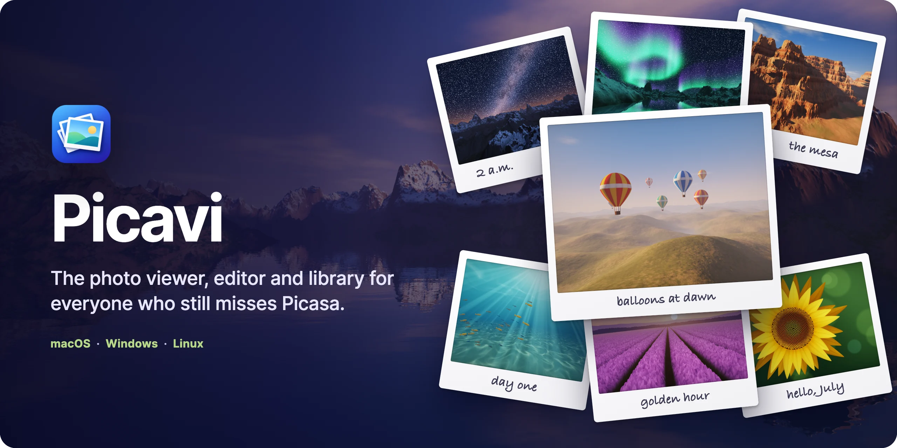
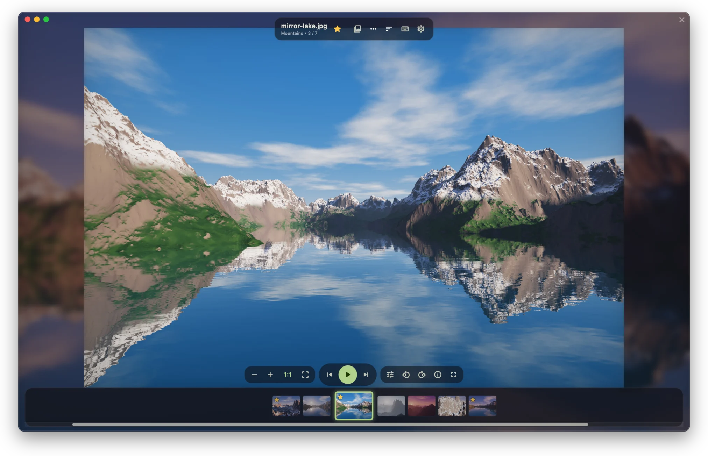
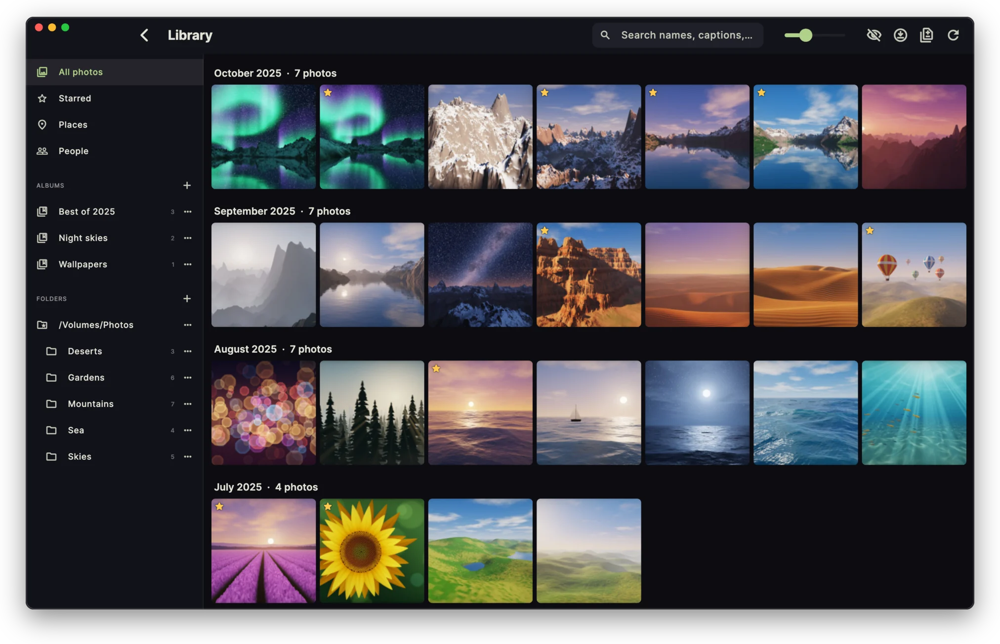
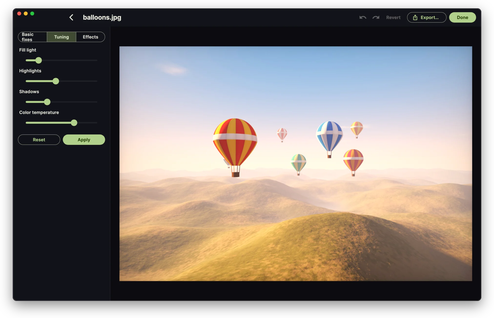
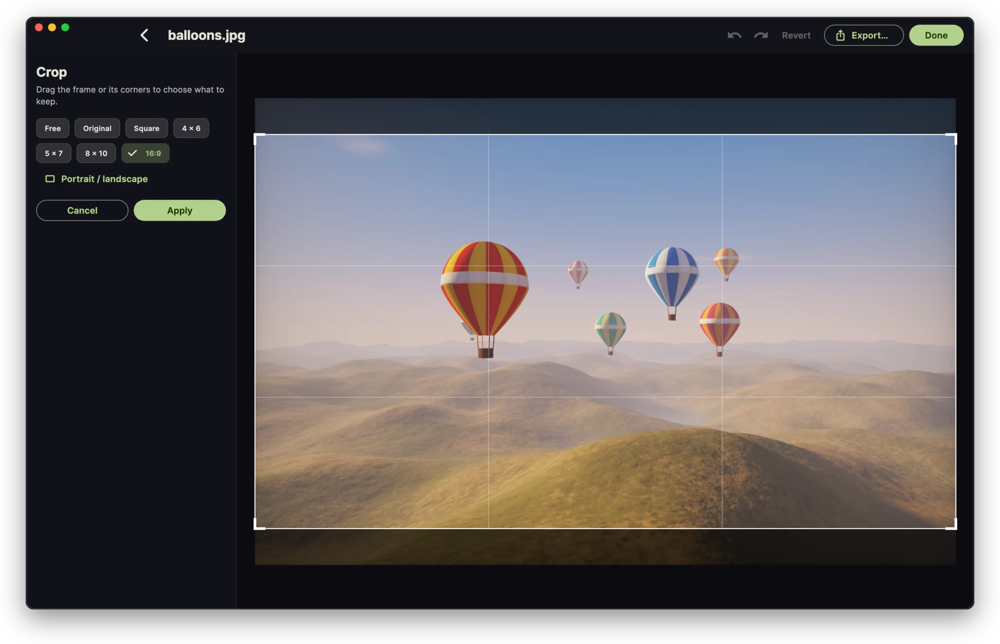
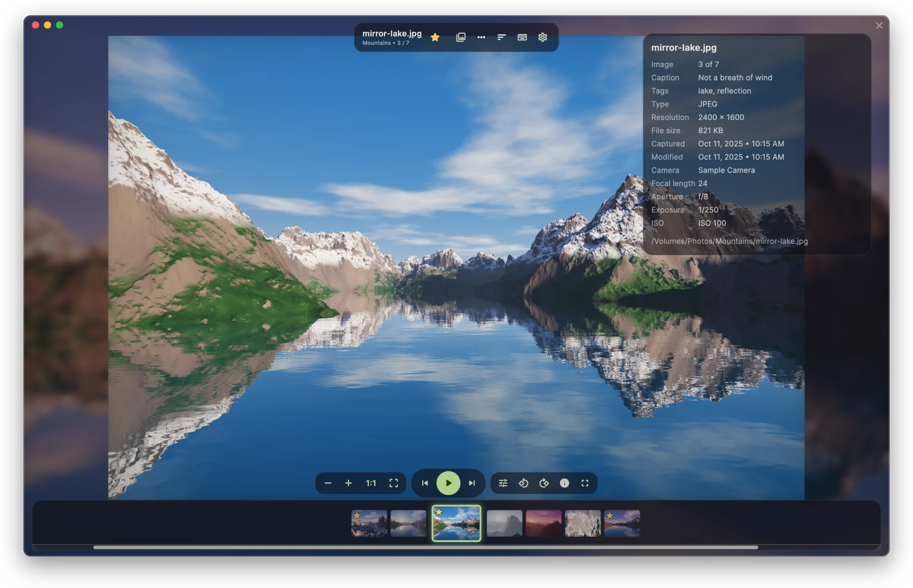
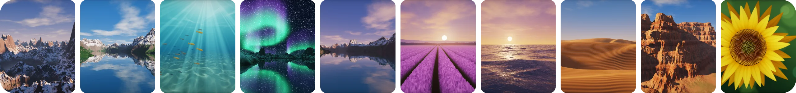

# Picavi — a free, open-source Picasa alternative for macOS, Windows and Linux

<p align="center">
  
</p>

<p align="center">
  <a href="https://github.com/ShreyashKore/picavi/releases"></a>
  
  
</p>

<p align="center">
  <a href="#download">Download</a> ·
  <a href="#features">Features</a> ·
  <a href="#picavi-vs-picasa">Picavi vs Picasa</a> ·
  <a href="#faq">FAQ</a> ·
  <a href="#keyboard-shortcuts">Shortcuts</a> ·
  <a href="docs/ROADMAP.md">Roadmap</a>
</p>

Google stopped supporting Picasa in March 2016. **Picavi** is a new desktop photo
app built around what made it good: double-click a photo and flip through the
whole folder, fix it in a click without touching the original, and keep your
library on your own disk — no account, no uploads, no subscription.



## Download

Get the latest build from the **[Releases page](https://github.com/ShreyashKore/picavi/releases)**.
Picavi is in alpha, so expect rough edges and please
[report what you find](https://github.com/ShreyashKore/picavi/issues).

| Platform | File | First launch |
|---|---|---|
| **macOS** 12 or later | `picavi-macos.dmg` | Not notarised yet: open it once, then allow it in **System Settings → Privacy & Security → Open Anyway** |
| **Windows** | `picavi-windows-setup.exe` | Not signed yet: in SmartScreen choose **More info → Run anyway** |
| **Linux** (Ubuntu 22.04+, Debian 12+) | `picavi-linux.deb` | `sudo apt install ./picavi-linux.deb` |

## Features

### 🖼️ A fast photo viewer

Open one image and every supported image in its folder loads into the filmstrip.

- Smooth zoom, pan and rotate, fit / fill window, full screen, and an EXIF info panel.
- Slideshow with adjustable timing, shuffle, loop and optional full screen.
- Rotations can be saved to the file — losslessly for JPEG (only the EXIF orientation changes), PNG and BMP.
- Rename, copy, move, show in Finder / Explorer, open with another app, or move to the Trash / Recycle Bin — one image or a whole selection.
- Sort by name (natural order, so `IMG_2` comes before `IMG_10`), date modified, size or type. The filmstrip refreshes when files are added or removed.
- Drop images or folders onto the window, and reopen recent folders from the start screen.

### 🗂️ A photo library that leaves your files where they are



- Add the folders where you keep photos and browse everything by month, folder, album or star.
- Search names, captions, tags, cameras, dates and people.
- **Stars, captions, tags and hidden photos** are saved next to your photos in a small `.picavi.json` file, so they travel with the folder.
- **Places** puts photos with GPS (or a location you set) on an OpenStreetMap map.
- **People** (macOS) finds faces on your Mac, groups look-alikes and lets you name them. Nothing is uploaded.
- **Duplicate finder** for exact copies; extras go to the Trash, never straight to deletion.
- **Import** from a camera or memory card into dated folders, skipping what you already have and changing nothing on the card.

### 🎨 Picasa-style editing that never touches the original



- **Basic fixes:** crop with print-size presets, straighten, red-eye, I'm Feeling Lucky, auto contrast and auto color.
- **Tuning:** fill light, highlights, shadows and color temperature.
- **Effects:** black & white, sepia, warmify, saturation, sharpen, soft focus, glow, film grain and vignette.
- Undo, redo and revert at any time. Edits live in `.picavi.json` (like Picasa's `.picasa.ini`) and follow photos you rename, move or copy in Picavi.
- Export edited copies as JPEG or PNG at any size, or apply quick fixes to a whole selection at once.

<table>
  <tr>
    <td width="50%"></td>
    <td width="50%"></td>
  </tr>
  <tr>
    <td align="center">Crop with print-size presets</td>
    <td align="center">Captions, tags and EXIF at a glance</td>
  </tr>
</table>

### ✨ And then do something with them

- Make photo collages (mosaic or grid) and contact sheets.
- Print 1, 2, 4 or 9 photos per page.
- Share through the macOS share menu, and select text inside photos with Live Text (macOS).
- Use it in English, Spanish, Hindi, Chinese, Marathi or Arabic.

## Picavi vs Picasa

An honest comparison. Picavi isn't finished, and most of the gaps are on the
[roadmap](docs/ROADMAP.md).

| | Picasa 3 | Picavi |
|---|:---:|:---:|
| Still developed | No (support ended in 2016) | Yes |
| Platforms | Windows, macOS | macOS, Windows, Linux |
| Works offline, on your own folders | ✅ | ✅ |
| Non-destructive edits in a sidecar file | ✅ `.picasa.ini` | ✅ `.picavi.json` |
| I'm Feeling Lucky, crop, straighten, red-eye | ✅ | ✅ |
| Tuning sliders and effects | ✅ | ✅ |
| Albums, stars, captions, tags | ✅ | ✅ |
| Photos on a map | ✅ | ✅ |
| Face recognition | ✅ | macOS only |
| Duplicate finder | ✅ | ✅ exact copies |
| Collage, contact sheet, print, camera import | ✅ | ✅ |
| HEIC and AVIF photos | ❌ | macOS only |
| Reads existing `.picasa.ini` data | ✅ | Not yet |
| RAW photos | ✅ | Not yet |
| Video playback and movie maker | ✅ | Not yet |

## FAQ

### Is Picavi a good replacement for Picasa?

If you used Picasa to look through folders, star and caption photos, make quick
fixes and keep everything on your own computer, Picavi covers that today. If you
depend on RAW files or videos, it doesn't yet.

### Can I bring my Picasa library over?

Your photos, yes: add the same folders to the Picavi library and it indexes them
in place. Picasa's own albums, face tags and unsaved edits (its `.picasa.ini`
files) aren't imported yet. Picavi leaves those files alone.

### Does it run on Apple silicon Macs, Windows 11 and Linux?

It runs on macOS 12 or later, Windows and Linux desktops. A few features use
macOS frameworks and are Mac-only for now: face grouping, Live Text, the share
menu, and HEIC, AVIF and TIFF decoding.

### Is it free? Do I need an account?

It's free, and there is no account or cloud. Photos, edits, tags and faces stay on
your computer. Picavi goes online only for map tiles while a map is open, and once
to fetch its interface font.

### Will it change or delete my originals?

Edits never do. The one thing written into a photo is a rotation you choose to
save. Deleting moves files to the Trash / Recycle Bin, and copies and moves never
overwrite.

### Which image formats are supported?

JPEG, PNG, GIF, WebP, BMP, ICO and SVG everywhere, plus HEIC, HEIF, AVIF and TIFF
on macOS. Details are [below](#supported-image-extensions).

## Keyboard shortcuts

Press `?` in the viewer to see these in the app.

| Keys | Action |
|---|---|
| `→` / `←` | Next / previous image |
| `Home` / `End` | First / last image |
| `Space` | Play / pause slideshow |
| `+` / `−` | Zoom in / out |
| `1` | Actual size (1:1) |
| `0` | Fit / fill window |
| `F` / `F11` | Full screen on / off |
| `R` / `Shift+R` | Rotate right / left |
| `⌘S` / `Ctrl+S` | Save rotation to the file |
| `I` | Show / hide image info |
| `E` | Edit image |
| `S` | Star / remove star |
| `L` | Open the library |
| `F2` | Rename |
| `Delete` / `⌫` | Move to Trash / Recycle Bin |
| `⌘C` / `Ctrl+C` | Copy image |
| `⌘A` / `Ctrl+A` | Select all |
| `⌘`/`Ctrl`-click, `Shift`-click | Add to / extend selection |
| `?` | Show keyboard shortcuts |
| `Esc` | Clear selection, stop slideshow, leave full screen, or close |

<details>
<summary>Library and editor shortcuts</summary>

**In the library**

| Keys | Action |
|---|---|
| Click, `⌘`/`Ctrl`-click, `Shift`-click | Select photos |
| Double-click, `Enter` | Open in the viewer |
| `⌘A` / `Ctrl+A` | Select all |
| `Esc` | Clear selection, or go back |

**In the editor**

| Keys | Action |
|---|---|
| `⌘Z` / `Ctrl+Z` | Undo |
| `⇧⌘Z` / `Ctrl+Shift+Z`, `Ctrl+Y` | Redo |
| `Enter` | Apply the open tool |
| `Esc` | Cancel the open tool, or close the editor |

</details>

## Supported image extensions

`bmp`, `gif`, `ico`, `jpeg`, `jpg`, `png`, `svg`, `webp` on every platform, plus
`heic`, `heif`, `avif`, `tif`, `tiff` on macOS (decoded by the system's ImageIO).

Picavi fits into your system's file manager:

- **macOS:** registers for common image types, so Finder's **Open With** works.
- **Linux:** installs a desktop entry for common image types.
- **Windows:** registers an **Open with** target for common image types, for the current user.

## Building from source

Picavi is a [Flutter](https://flutter.dev) desktop app (code name `oiv`, "Open Image
Viewer"). [AGENTS.md](AGENTS.md) describes the architecture and conventions.

### Run it

```bash
flutter pub get
flutter run -d macos
```

You can also pass a file path directly:

```bash
flutter run -d macos --dart-entrypoint-args=/absolute/path/to/image.jpg
```

### Quality checks

```bash
flutter analyze
flutter test
```

### Releasing

Bump `version` in `pubspec.yaml`, commit, then push a matching tag:

```bash
git tag v1.0.4
git push origin v1.0.4
```

[release.yml](.github/workflows/release.yml) builds a macOS `.dmg`, a Linux `.deb`
and a Windows installer, and publishes them as a GitHub release once all three have
built and the checks pass. Run the workflow by hand to build the packages without
releasing. A suffixed tag such as `v1.0.4-alpha.1` publishes a pre-release of that
version. Packages are not signed with a developer certificate or notarised.

---

<p align="center">
  
</p>

<p align="center"><sub>
The photos shown here are computer-generated sample images made for this project.<br>
Picasa is a trademark of Google LLC. Picavi is an independent project, not affiliated with or endorsed by Google.
</sub></p>
